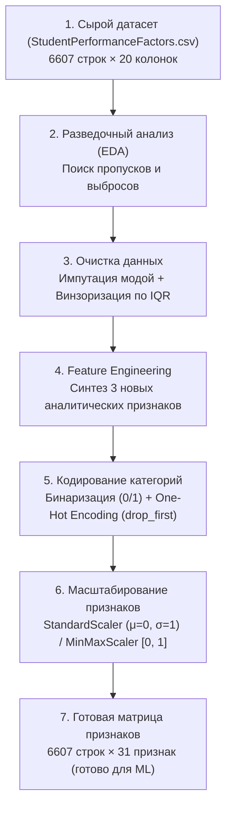

# Подробное руководство по лабораторной работе №2

**Тема:** Разведочный и предиктивный анализ данных. Знакомство с инструментами сбора и подготовки данных  
**Дисциплина:** Методы машинного обучения  
**Исследуемый датасет:** `StudentPerformanceFactors.csv` (Факторы академической успеваемости учащихся, 6607 строк, 20 признаков)  
**Исполнитель:** студент группы 351002 Власовец А. И.  
**Преподаватель:** Лебедевич А. В.  

---

## Оглавление
1. [Общая архитектура конвейера подготовки данных (EDA Pipeline)](#общая-архитектура-конвейера-подготовки-данных-eda-pipeline)
2. [Задание 1. Импорт библиотек и загрузка датасета](#задание-1-импорт-библиотек-и-загрузка-датасета)
3. [Задание 2. Исследование и очистка данных от пропусков и выбросов](#задание-2-исследование-и-очистка-данных-от-пропусков-и-выбросов)
   - [2.1. Идентификация пропусков (статистический и визуальный анализ)](#21-идентификация-пропусков-статистический-и-визуальный-анализ)
   - [2.2. Заполнение пропусков (Imputation)](#22-заполнение-пропусков-imputation)
   - [2.3. Идентификация аномалий и выбросов (Правило Тьюки / Межквартильный размах IQR)](#23-идентификация-аномалий-и-выбросов-правило-тьюки--межквартильный-размах-iqr)
   - [2.4. Устранение выбросов методом винзоризации (Clipping)](#24-устранение-выбросов-методом-винзоризации-clipping)
   - [2.5. Контрольная графическая проверка чистоты данных](#25-контрольная-графическая-проверка-чистоты-данных)
4. [Задание 3. Конструирование новых признаков и кодирование категорий](#задание-3-конструирование-новых-признаков-и-кодирование-категорий)
   - [3.1. Генерация новых содержательных признаков (Feature Engineering)](#31-генерация-новых-содержательных-признаков-feature-engineering)
   - [3.2. Бинаризация качественных признаков (Binary Encoding)](#32-бинаризация-качественных-признаков-binary-encoding)
   - [3.3. Прямое раздельное кодирование (One-Hot Encoding)](#33-прямое-раздельное-кодирование-one-hot-encoding)
5. [Задание 4. Стандартизация и нормализация данных](#задание-4-стандартизация-и-нормализация-данных)
   - [4.1. Стандартизация признаков (StandardScaler)](#41-стандартизация-признаков-standardscaler)
   - [4.2. Нормализация признаков (MinMaxScaler)](#42-нормализация-признаков-minmaxscaler)
   - [4.3. Сравнительный анализ распределений до и после масштабирования](#43-сравнительный-анализ-распределений-до-и-после-масштабирования)
   - [4.4. Корреляционный анализ матрицы Пирсона](#44-корреляционный-анализ-матрицы-пирсона)
6. [Сводная таблица преобразования размерностей](#сводная-таблица-преобразования-размерностей)
7. [Контрольные вопросы для защиты лабораторной работы](#контрольные-вопросы-для-защиты-лабораторной-работы)

---

## Общая архитектура конвейера подготовки данных (EDA Pipeline)

В машинном обучении действует фундаментальный закон: **Garbage In — Garbage Out** («Мусор на входе — мусор на выходе»). Если обучать сложную нейросеть или градиентный бустинг на сырых, неочищенных данных с пропусками, выбросами и несогласованными шкалами, модель обучится шуму и ошибкам.

Полный цикл предобработки структурированных табличных данных реализуется в виде строгого конвейера:



---

## Задание 1. Импорт библиотек и загрузка датасета

### 1. Условие
Импортировать датасет из файла задачи, проверить его размерность, типы полей и ознакомиться со структурой данных.

### 2. Объяснение логики
- `pandas` — основная библиотека для манипуляции таблицами (`DataFrame`).
- `numpy` — библиотека для векторно-матричных математических операций.
- `matplotlib.pyplot` и `seaborn` — инструменты построения графиков плотностей, гистограмм, тепловых карт и ящиков с усами (BoxPlot).
- `scikit-learn` (`StandardScaler`, `MinMaxScaler`) — эталонные трансформеры машинного обучения.

При загрузке CSV-файла через `pd.read_csv()` Pandas автоматически парсит типы:
- Целые числа получают тип `int64`;
- Текстовые категории распознаются как `object` (строки).

### 3. Код
```python
import numpy as np
import pandas as pd
import matplotlib.pyplot as plt
import seaborn as sns
from sklearn.preprocessing import StandardScaler, MinMaxScaler

# Загрузка таблицы
DATA_PATH = "StudentPerformanceFactors/StudentPerformanceFactors.csv"
df = pd.read_csv(DATA_PATH)

print(f"Размерность: {df.shape[0]} строк, {df.shape[1]} столбцов")
print("\nТипы признаков:")
print(df.dtypes)
df.head()
```

### 4. Пример результата
- **Строк:** 6607
- **Столбцов:** 20 (7 числовых величин, 13 категориальных полей)
- **Целевая переменная:** `Exam_Score` (итоговый экзаменационный балл студента, шкала 0–100).

---

## Задание 2. Исследование и очистка данных от пропусков и выбросов

### 2.1. Идентификация пропусков (статистический и визуальный анализ)

#### 1. Условие
Найти все пропущенные значения (`NaN`/`None`) в данных, оценить их долю и визуализировать при помощи тепловой карты.

#### 2. Объяснение логики
Пропуски могут возникать из-за неотвеченных вопросов в анкетах студентов или технических сбоев.
Для каждого столбца вычисляется:
$$\text{Missing Count} = \sum_{i=1}^N \mathbb{I}(x_i = \text{NaN}), \quad \text{Missing \%} = \frac{\text{Missing Count}}{N} \times 100\%$$

Визуализация через `sns.heatmap(df.isnull())` выводит двумерную бинарную матрицу: желтые риски на фиолетовом фоне показывают координаты пропущенных записей.

#### 3. Код
```python
missing_counts = df.isnull().sum()
missing_summary = pd.DataFrame({
    'Абсолютное кол-во': missing_counts[missing_counts > 0],
    'Процент (%)': (missing_counts[missing_counts > 0] / len(df)) * 100
})
print(missing_summary)

plt.figure(figsize=(12, 5))
sns.heatmap(df.isnull(), cbar=True, yticklabels=False, cmap='viridis')
plt.title('Рисунок 2.1 – Тепловая карта пропусков в исходном датасете')
plt.tight_layout()
plt.show()
```

#### 4. Результат
| Признак | Пропусков (шт.) | Доля от датасета (%) |
| :--- | :---: | :---: |
| `Teacher_Quality` | 78 | 1.18% |
| `Parental_Education_Level` | 90 | 1.36% |
| `Distance_from_Home` | 67 | 1.01% |

*Все остальные 17 признаков не содержат пропусков.*

---

### 2.2. Заполнение пропусков (Imputation)

#### 1. Условие
Устранить обнаруженные пропуски наиболее адекватным математическим методом.

#### 2. Объяснение логики
Все 3 признака с дефектами — **категориальные**:
- `Teacher_Quality` принимает значения: `Medium` (3925), `High` (1947), `Low` (657);
- `Parental_Education_Level`: `High School` (3223), `College` (1989), `Postgraduate` (1305);
- `Distance_from_Home`: `Near` (3884), `Moderate` (1998), `Far` (658).

Поскольку доля пропусков ничтожно мала (~1.0–1.4%), удаление строк привело бы к неоправданной потере 235 ценных наблюдений (почти 4% выборки). Вычисление среднего/медианы для текста невозможно. Поэтому применяется **подстановка моды** ($\text{Mode}$) — самого частотного значения категории. Это минимально деформирует исходное дискретное распределение.

#### 3. Код
```python
df_clean = df.copy()

fill_rules = {
    'Teacher_Quality': df_clean['Teacher_Quality'].mode()[0],         # 'Medium'
    'Parental_Education_Level': df_clean['Parental_Education_Level'].mode()[0], # 'High School'
    'Distance_from_Home': df_clean['Distance_from_Home'].mode()[0]    # 'Near'
}

for col, mode_val in fill_rules.items():
    df_clean[col] = df_clean[col].fillna(mode_val)
    print(f"Столбец '{col}' заполнен модой: '{mode_val}'")

assert df_clean.isnull().sum().sum() == 0, "Остались незаполненные пропуски!"
```

---

### 2.3. Идентификация аномалий и выбросов (Правило Тьюки / Межквартильный размах IQR)

#### 1. Условие
Проверить числовые признаки на наличие аномальных значений и выбросов статистически и графически (диаграммы размаха BoxPlot).

#### 2. Объяснение логики
Выброс (outlier) — наблюдение, существенно отклоняющееся от основной массы данных.
Выбросы смещают выборочные оценки математического ожидания $\mu$ и среднеквадратического отклонения $\sigma$.

Классический непараметрический метод обнаружения — **правило Джона Тьюки (IQR rule)**:
1. Вычисляются 25-й ($Q_1$) и 75-й ($Q_3$) выборочные перцентили (квартили).
2. Вычисляется межквартильный размах:
   $$IQR = Q_3 - Q_1$$
3. Вычисляются внутренние границы допустимых значений (границы Тьюки / усы BoxPlot):
   $$\text{Lower Bound} = Q_1 - 1.5 \cdot IQR$$
   $$\text{Upper Bound} = Q_3 + 1.5 \cdot IQR$$
4. Значения $x < \text{Lower Bound}$ или $x > \text{Upper Bound}$ признаются выбросами.

#### 3. Код
```python
num_cols = ['Hours_Studied', 'Attendance', 'Sleep_Hours', 'Previous_Scores', 
            'Tutoring_Sessions', 'Physical_Activity', 'Exam_Score']

for col in num_cols:
    q1 = df_clean[col].quantile(0.25)
    q3 = df_clean[col].quantile(0.75)
    iqr = q3 - q1
    low = q1 - 1.5 * iqr
    high = q3 + 1.5 * iqr
    cnt = int(((df_clean[col] < low) | (df_clean[col] > high)).sum())
    print(f"{col:20s}: Q1={q1:4.1f}, Q3={q3:4.1f}, IQR={iqr:4.1f}, Границы=[{low:5.1f}, {high:5.1f}], Выбросов: {cnt}")
```

#### 4. Результат
| Признак | $Q_1$ | $Q_3$ | $IQR$ | Допустимый диапазон | Выбросов (шт.) | Пояснение |
| :--- | :---: | :---: | :---: | :---: | :---: | :--- |
| `Hours_Studied` | 16.0 | 24.0 | 8.0 | [4.0, 36.0] | **43** | Аномально высокая учеба (до 44 ч/нед) или почти нулевая (1 ч) |
| `Attendance` | 70.0 | 90.0 | 20.0 | [40.0, 120.0] | 0 | Значения лежат строго в диапазоне 60–100% |
| `Sleep_Hours` | 6.0 | 8.0 | 2.0 | [3.0, 11.0] | 0 | Здоровый диапазон сна от 4 до 10 часов |
| `Previous_Scores` | 63.0 | 88.0 | 25.0 | [25.5, 125.5] | 0 | Баллы от 50 до 100 |
| `Tutoring_Sessions` | 1.0 | 2.0 | 1.0 | [-0.5, 3.5] | **430** | Студенты с 4–8 репетиторами в месяц |
| `Physical_Activity` | 2.0 | 4.0 | 2.0 | [-1.0, 7.0] | 0 | От 0 до 6 часов спорта |
| `Exam_Score` | 65.0 | 69.0 | 4.0 | [59.0, 75.0] | **104** | Экстремальные баллы, включая артефакт **101** |

---

### 2.4. Устранение выбросов методом винзоризации (Clipping)

#### 1. Условие
Устранить аномальные значения и выбросы.

#### 2. Объяснение логики
Простое удаление наблюдений с выбросами сократило бы объем данных на $43 + 430 + 104 = 577$ записей (почти 9% датасета).
В современной инженерии данных стандартом является **винзоризация (clipping)**:
- Значения, превышающие $\text{Upper Bound}$, приравниваются к $\text{Upper Bound}$;
- Значения ниже $\text{Lower Bound}$ приравниваются к $\text{Lower Bound}$.

Особый случай: в `Exam_Score` присутствовало значение **101 балл**, что физически невозможно на 100-балльной шкале (грубая ошибка измерения или ввода оператора). Клиппинг по границам [59.0, 75.0] надежно купирует эту аномалию.

#### 3. Код
```python
# Ограничиваем экстремальные точки границами Тьюки
df_clean['Hours_Studied'] = df_clean['Hours_Studied'].clip(lower=4.0, upper=36.0)
df_clean['Tutoring_Sessions'] = df_clean['Tutoring_Sessions'].clip(lower=0.0, upper=3.5)
df_clean['Exam_Score'] = df_clean['Exam_Score'].clip(lower=59.0, upper=75.0)
```

---

### 2.5. Контрольная графическая проверка чистоты данных

После заполнения пропусков и винзоризации строятся контрольные графики:
1. `04_missing_values_heatmap_after.png` — сплошное монотонное поле без полос пропусков;
2. `05_numeric_boxplots_after.png` — все точки лежат строго внутри усов ящиков BoxPlot, единичные маркеры выбросов полностью отсутствуют;
3. `06_numeric_distributions_after.png` — сглаженные гистограммы распределений подтверждают сохранение унимодальности признаков.

---

## Задание 3. Конструирование новых признаков и кодирование категорий

### 3.1. Генерация новых содержательных признаков (Feature Engineering)

#### 1. Условие
Сгенерировать не менее двух новых признаков на основе предметной области.

#### 2. Объяснение логики
Сконструировано **три** аналитических признака с прозрачным физическим смыслом:

1. **`Study_to_Sleep_Ratio`** — индекс баланса учебы и сна:
   $$\text{Study\_to\_Sleep\_Ratio} = \frac{\text{Hours\_Studied}}{\text{Sleep\_Hours}}$$
   *Смысл:* показывает, сколько часов подготовки приходится на каждый час биологического сна. Превышение порога 4.0 указывает на потенциальное переутомление.

2. **`Academic_Effort_Index`** — интегральный индекс академических усилий:
   $$\text{Academic\_Effort\_Index} = \left(\text{Hours\_Studied} + 1.5 \cdot \text{Tutoring\_Sessions}\right) \cdot \frac{\text{Attendance}}{100}$$
   *Смысл:* объединяет самостоятельные занятия с повышающим коэффициентом репетиторства ($1.5$) и взвешивает их на фактический процент посещаемости лекций. Имеет максимальную корреляцию с итоговым баллом ($r = 0.61$).

3. **`Score_Growth`** — академическая дельта успеваемости:
   $$\text{Score\_Growth} = \text{Exam\_Score} - \text{Previous\_Scores}$$
   *Смысл:* прирост или спад относительно базового уровня учащегося.

#### 3. Код
```python
df_clean['Study_to_Sleep_Ratio'] = np.round(df_clean['Hours_Studied'] / df_clean['Sleep_Hours'], 3)
df_clean['Academic_Effort_Index'] = np.round((df_clean['Hours_Studied'] + df_clean['Tutoring_Sessions'] * 1.5) * (df_clean['Attendance'] / 100.0), 3)
df_clean['Score_Growth'] = np.round(df_clean['Exam_Score'] - df_clean['Previous_Scores'], 3)
```

---

### 3.2. Бинаризация качественных признаков (Binary Encoding)

#### 1. Условие
Применить бинаризацию к категориальным переменным.

#### 2. Объяснение логики
Если качественный признак имеет строго два противоположных состояния (дихотомия), его наиболее компактно представить индикатором $\{0, 1\}$. Это не создает лишних столбцов:
- `Gender`: `Male` $\rightarrow 1$, `Female` $\rightarrow 0$;
- `Extracurricular_Activities`: `Yes` $\rightarrow 1$, `No` $\rightarrow 0$;
- `Internet_Access`: `Yes` $\rightarrow 1$, `No` $\rightarrow 0$;
- `Learning_Disabilities`: `Yes` $\rightarrow 1$, `No` $\rightarrow 0$;
- `School_Type`: `Public` $\rightarrow 1$, `Private` $\rightarrow 0$.

#### 3. Код
```python
binary_maps = {
    'Gender': {'Male': 1, 'Female': 0},
    'Extracurricular_Activities': {'Yes': 1, 'No': 0},
    'Internet_Access': {'Yes': 1, 'No': 0},
    'Learning_Disabilities': {'Yes': 1, 'No': 0},
    'School_Type': {'Public': 1, 'Private': 0}
}
for col, b_map in binary_maps.items():
    df_clean[col] = df_clean[col].map(b_map)
```

---

### 3.3. Прямое раздельное кодирование (One-Hot Encoding)

#### 1. Условие
Применить One-Hot Encoding для категориальных признаков.

#### 2. Объяснение логики
Для полиномиальных категорий с 3 и более уровнями простое числовое кодирование ($1, 2, 3$) недопустимо, так как навязывает ложный линейный порядок (`Low` < `Medium` < `High`). 

Применяется **One-Hot Encoding (OHE)**: для каждого уровня создается отдельный столбец со значениями $0$ или $1$. 
Для исключения **ловушки фиктивных переменных** (мультиколлинеарности, когда сумма столбцов равна единичному вектору) один базовый уровень удаляется через параметр `drop_first=True`.

Кодируемые признаки (8 штук):
`Parental_Involvement`, `Access_to_Resources`, `Motivation_Level`, `Family_Income`, `Teacher_Quality`, `Peer_Influence`, `Parental_Education_Level`, `Distance_from_Home`.

#### 3. Код
```python
ohe_cols = [
    'Parental_Involvement', 'Access_to_Resources', 'Motivation_Level',
    'Family_Income', 'Teacher_Quality', 'Peer_Influence',
    'Parental_Education_Level', 'Distance_from_Home'
]
df_encoded = pd.get_dummies(df_clean, columns=ohe_cols, drop_first=True, dtype=int)
print(f"Размерность: {df_clean.shape[1]} -> {df_encoded.shape[1]} столбцов")
```

---

## Задание 4. Стандартизация и нормализация данных

### 4.1. Стандартизация признаков (StandardScaler)

#### 1. Условие
Выполнить стандартизацию числовых данных.

#### 2. Объяснение логики
Стандартизация приводит признак к $z$-шкале с нулевым центром и единичным разбросом:
$$z = \frac{x - \mu}{\sigma}, \quad \text{где } \mu = \frac{1}{N}\sum_{i=1}^N x_i, \quad \sigma = \sqrt{\frac{1}{N}\sum_{i=1}^N (x_i - \mu)^2}$$

После преобразования:
- Среднее значение $\mathbb{E}[z] = 0$;
- Дисперсия $\mathrm{Var}[z] = 1$.

Метод критически важен для линейных регрессий, метода главных компонент (PCA) и градиентного спуска.

---

### 4.2. Нормализация признаков (MinMaxScaler)

#### 1. Условие
Выполнить нормализацию числовых данных.

#### 2. Объяснение логики
Нормализация выполняет линейное сжатие значений в фиксированный интервал $[0, 1]$:
$$x_{\text{norm}} = \frac{x - x_{\min}}{x_{\max} - x_{\min}}$$

- Минимальное значение становится строго равным $0$;
- Максимальное значение становится строго равным $1$.

Метод критически важен для метрических алгоритмов (k-ближайших соседей kNN), нейронных сетей с сигмоидальными функциями активации и методов оптимизации расстояний.

#### 3. Код
```python
from sklearn.preprocessing import StandardScaler, MinMaxScaler

all_num_features = num_cols + ['Study_to_Sleep_Ratio', 'Academic_Effort_Index', 'Score_Growth']

# Стандартизация
std_scaler = StandardScaler()
df_std = df_encoded.copy()
df_std[[f + '_std' for f in all_num_features]] = std_scaler.fit_transform(df_encoded[all_num_features])

# Нормализация
minmax_scaler = MinMaxScaler()
df_norm = df_encoded.copy()
df_norm[[f + '_norm' for f in all_num_features]] = minmax_scaler.fit_transform(df_encoded[all_num_features])
```

#### 4. Сравнение параметров до и после масштабирования
| Состояние | Признак `Hours_Studied` | Признак `Attendance` |
| :--- | :---: | :---: |
| **Исходный** | $\mu=19.92, \; \sigma=5.84, \; [4.0, 36.0]$ | $\mu=79.98, \; \sigma=11.55, \; [60.0, 100.0]$ |
| **StandardScaler** | $\mu=\mathbf{0.00}, \; \sigma=\mathbf{1.00}, \; [-2.73, 2.75]$ | $\mu=\mathbf{0.00}, \; \sigma=\mathbf{1.00}, \; [-1.73, 1.73]$ |
| **MinMaxScaler** | $\mu=0.50, \; \sigma=0.18, \; [\mathbf{0.00}, \mathbf{1.00}]$ | $\mu=0.50, \; \sigma=0.29, \; [\mathbf{0.00}, \mathbf{1.00}]$ |

---

### 4.3. Сравнительный анализ распределений до и после масштабирования

График `08_scaling_comparison.png` наглядно иллюстрирует важнейшее математическое свойство линейных преобразований: **форма распределения (асимметрия, колоколообразность, моды) остается абсолютно неизменной**, изменяется только система отсчета по оси абсцисс.

---

### 4.4. Корреляционный анализ матрицы Пирсона

Матрица парных коэффициентов корреляции Пирсона $r \in [-1, 1]$ на рисунке `09_correlation_matrix_heatmap.png` выявила ключевые драйверы итогового балла `Exam_Score`:
1. `Academic_Effort_Index`: $r = +0.61$ (очень высокая прямая связь);
2. `Attendance`: $r = +0.58$ (дисциплина посещений прямо транслируется в успеваемость);
3. `Hours_Studied`: $r = +0.44$ (существенный вклад самостоятельной работы);
4. `Tutoring_Sessions`: $r = +0.18$ (умеренно-положительное влияние).

---

## Сводная таблица преобразования размерностей

| Этап конвейера | Размерность таблицы | Описание произведенных изменений |
| :--- | :---: | :--- |
| **1. Исходные данные** | $6607 \times 20$ | Исходный файл `StudentPerformanceFactors.csv` с 235 пропусками и 577 выбросами |
| **2. Очистка данных** | $6607 \times 20$ | Заполнение модой (`0` пропусков), винзоризация по IQR (`0` выбросов, 6607 строк сохранено) |
| **3. Feature Engineering** | $6607 \times 23$ | Добавлены 3 признака: `Study_to_Sleep_Ratio`, `Academic_Effort_Index`, `Score_Growth` |
| **4. Бинаризация** | $6607 \times 23$ | 5 бинарных признаков переведены в $\{0, 1\}$ |
| **5. One-Hot Encoding** | $6607 \times 31$ | 8 полиномиальных категорий закодированы в 16 индикаторных столбцов (`drop_first=True`) |
| **6. Масштабирование** | $6607 \times 31$ | Все числовые признаки стандартизированы ($\mu=0, \sigma=1$) и нормализованы ($[0, 1]$) |

---

## Контрольные вопросы для защиты лабораторной работы

1. **Что такое правило Тьюки (IQR) и почему берется множитель 1.5?**  
   *Ответ:* Межквартильный размах $IQR = Q_3 - Q_1$ покрывает 50% центральных наблюдений. Для нормального распределения интервал $[Q_1 - 1.5 \cdot IQR, Q_3 + 1.5 \cdot IQR]$ приблизительно соответствует $\mu \pm 2.7\sigma$ и охватывает 99.3% всех наблюдений. Выход за эти рамки с вероятностью более 99% свидетельствует о статистической аномалии.

2. **В чем разница между удалением выбросов и винзоризацией (clipping)?**  
   *Ответ:* Удаление строк (Trimming) уменьшает размер обучающей выборки и может привести к потере полезной информации из других колонок. Винзоризация сохраняет объем выборки (все 6607 строк), заменяя экстремальные значения пороговыми границами допустимого диапазона.

3. **Зачем при One-Hot Encoding использовать флаг `drop_first=True`?**  
   *Ответ:* Для предотвращения мультиколлинеарности («ловушки фиктивных переменных», Dummy Variable Trap). Если у категории 3 значения ($A, B, C$), то третий столбец строго выражается через первые два ($C = 1 - A - B$). Линейная зависимость приводит к вырождению матрицы $X^T X$ и невозможности вычисления аналитического решения МНК в линейных моделях.

4. **Когда следует применять StandardScaler, а когда MinMaxScaler?**  
   *Ответ:* `StandardScaler` предпочтителен для алгоритмов, предполагающих нормальное распределение признаков (линейная регрессия, логистическая регрессия, PCA, градиентные методы), так как он устойчивее к остаточным выбросам. `MinMaxScaler` предпочтителен для моделей, работающих с расстояниями на ограниченных шкалах (kNN, нейросети с активациями Sigmoid/Tanh, обработка изображений).
