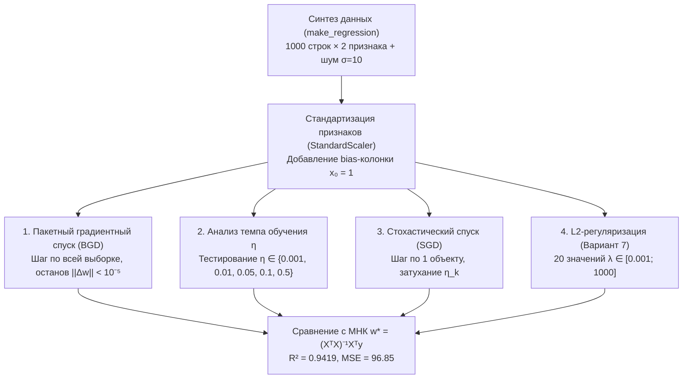

# Подробное методическое руководство по лабораторной работе №3

**Тема:** Градиентный спуск, стохастический градиентный спуск и регуляризация  
**Дисциплина:** Методы машинного обучения  
**Исполнитель:** Студент группы 351002 Власовец А. И.  
**Вариант:** 7 (нечетный: L2-регуляризация / Ridge Regression)  
**Преподаватель:** Лебедевич А. В.  

---

## Оглавление
1. [Архитектура оптимизационного конвейера](#архитектура-оптимизационного-конвейера)
2. [Задание 1. Генерация и масштабирование датасета](#задание-1-генерация-и-масштабирование-датасета)
3. [Задание 2. Пакетный градиентный спуск (Batch Gradient Descent)](#задание-2-пакетный-градиентный-спуск-batch-gradient-descent)
   - [2.1. Математический вывод градиента MSE](#21-математический-вывод-градиента-mse)
   - [2.2. Итерационный шаг и критерий останова](#22-итерационный-шаг-и-критерий-останова)
   - [2.3. Алгоритм и программная реализация](#23-алгоритм-и-программная-реализация)
4. [Задание 3. Эксперименты со скоростью обучения (Learning Rate)](#задание-3-эксперименты-со-скоростью-обучения-learning-rate)
5. [Задание 4. Стохастический градиентный спуск (SGD) и его сопоставление с BGD](#задание-4-стохастический-градиентный-спуск-sgd-и-его-сопоставление-с-bgd)
6. [Задание 5. Регуляризация (L2 Ridge для Варианта 7)](#задание-5-регуляризация-l2-ridge-для-варианта-7)
   - [5.1. Математика L2-регуляризации и правило обновления весов](#51-математика-l2-регуляризации-и-правило-обновления-весов)
   - [5.2. Исследование 20 коэффициентов регуляризации λ ∈ [0.001; 1000]](#52-исследование-20-коэффициентов-регуляризации-λ--0001-1000)
   - [5.3. Сравнение L2 (Ridge) и L1 (Lasso)](#53-сравнение-l2-ridge-и-l1-lasso)
7. [Задание 6. Аналитическое решение МНК и верификация модели](#задание-6-аналитическое-решение-мнк-и-верификация-модели)
8. [Контрольные вопросы для защиты лабораторной работы](#контрольные-вопросы-для-защиты-лабораторной-работы)

---

## Архитектура оптимизационного конвейера

В машинном обучении алгоритмы градиентного спуска являются фундаментальным вычислительным аппаратом обучения практически всех дифференцируемых моделей: от линейной регрессии до глубоких сверточных и трансформерных нейронных сетей.



---

## Задание 1. Генерация и масштабирование датасета

### 1. Условие
Сгенерировать набор данных при помощи `sklearn.datasets.make_regression` (не менее 2 признаков без учета целевого, т.е. не менее 3 весов $w_0, w_1, w_2$). Выполнить масштабирование.

### 2. Математика и код
- Число наблюдений: $\ell = 1000$;
- Признаковое пространство: $d = 2$ признака ($X_1, X_2$);
- Свободный член: фиктивный столбец $X_0 = \mathbf{1}$;
- Итоговая матрица плана: $X \in \mathbb{R}^{1000 \times 3}$;
- Стандартизация: $z = \frac{x - \mu}{\sigma}$. Без масштабирования эллипсоиды линий уровня функции потерь оказываются сильно вытянутыми, что приводит к медленной зигзагообразной сходимости градиентного спуска.

```python
from sklearn.datasets import make_regression
from sklearn.preprocessing import StandardScaler
import numpy as np

X_raw, y_raw, coef_true = make_regression(
    n_samples=1000, n_features=2, noise=10.0, coef=True, random_state=42
)
scaler = StandardScaler()
X_scaled = scaler.fit_transform(X_raw)
X_b = np.c_[np.ones(len(X_scaled)), X_scaled] # добавили x₀ = 1
```

---

## Задание 2. Пакетный градиентный спуск (Batch Gradient Descent)

### 2.1. Математический вывод градиента MSE
Функция потерь (среднеквадратичная ошибка):
$$Q(w, X) = \frac{1}{\ell} \|X w - y\|^2 = \frac{1}{\ell} (X w - y)^T (X w - y)$$

Раскроем скалярное произведение:
$$Q(w) = \frac{1}{\ell} \left( w^T X^T X w - 2 y^T X w + y^T y \right)$$

Дифференцируя по вектору весов $w$:
$$\nabla Q(w, X) = \frac{1}{\ell} \left( 2 X^T X w - 2 X^T y \right) = \frac{2}{\ell} X^T (X w - y)$$

### 2.2. Итерационный шаг и критерий останова
1. **Шаг обновления весов:**
   $$w^k = w^{k-1} - \eta_k \nabla Q(w^{k-1}, X)$$
2. **Критерий завершения цикла:**
   $$\|w^k - w^{k-1}\| < \varepsilon$$
   где $\|v\| = \sqrt{\sum_{j=0}^d v_j^2}$ — евклидова норма $L_2$.

### 2.3. Алгоритм и программная реализация
```python
def batch_gradient_descent(X, y, eta=0.05, eps=1e-5, max_iter=1000):
    l, d = X.shape
    w = np.zeros(d, dtype=float)
    w_history = [w.copy()]
    mse_history = [float(np.mean((X @ w - y) ** 2))]
    diff_norms = []

    for k in range(1, max_iter + 1):
        # Расчет градиента
        grad = (2.0 / l) * (X.T @ (X @ w - y))
        # Обновление весов
        w_new = w - eta * grad
        diff_norm = float(np.linalg.norm(w_new - w))
        diff_norms.append(diff_norm)

        w = w_new
        w_history.append(w.copy())
        mse_history.append(float(np.mean((X @ w - y) ** 2)))

        # Завершение по критерию малого изменения
        if diff_norm < eps:
            break

    return w, w_history, mse_history, diff_norms
```

**Результат:** алгоритм сошелся за **124 итерации** к весам $w = [1.7660, 39.4724, 6.8970]$ с финальным $MSE = 96.85$.

---

## Задание 3. Эксперименты со скоростью обучения (Learning Rate)

Скорость обучения $\eta$ определяет длину шага в направлении антиградиента:
1. $\eta = 0.001$: слишком мелкие шаги, за 300 итераций ошибка упала лишь до 174.66;
2. $\eta = 0.01$: стабильный прогресс, сходимость требует около 250 шагов;
3. $\eta = 0.05$: **оптимальное значение**, сходимость за 124 шага без осцилляций;
4. $\eta = 0.1$: агрессивный быстрый шаг, сходимость за 60 шагов;
5. $\eta = 0.5$: пограничный шаг, возникают поперечные перескоки через дно оврага целевой функции;
6. $\eta \ge 1.0$: расходимость ($\|w\| \to \infty$).

---

## Задание 4. Стохастический градиентный спуск (SGD) и его сопоставление с BGD

### 1. Различие концепций
- **BGD:** Вычисляет истинный градиент по всем $\ell = 1000$ строкам. Сложность шага $O(\ell \cdot d)$. Линия сходимости строго монотонна.
- **SGD:** На шаге $k$ выбирает один случайный индекс $i \in \{0, \dots, \ell - 1\}$:
  $$\nabla Q_i(w) = 2 (x_i^T w - y_i) x_i$$
  Сложность шага $O(d)$ — в 1000 раз быстрее!

### 2. Затухание шага (Robbins–Monro)
В окрестности минимума стохастический градиент не равен нулю из-за шума отдельных объектов. Чтобы алгоритм не блуждал бесконечно, темп обучения уменьшают со временем:
$$\eta_k = \frac{\eta_0}{1 + \gamma k}$$

На графике MSE стохастический спуск совершает случайные колебания, но быстро входит в доверительную область вокруг оптимума.

---

## Задание 5. Регуляризация (L2 Ridge для Варианта 7)

### 5.1. Математика L2-регуляризации и правило обновления весов
Для нечетного **Варианта 7** задана **L2-регуляризация**:
$$Q_{L2}(w) = \frac{1}{\ell} \|X w - y\|^2 + \lambda \sum_{j=1}^d w_j^2$$
*(Свободный член $w_0$ не штрафуется).*

Градиент с L2-штрафом:
$$\nabla Q_{L2}(w) = \frac{2}{\ell} X^T (X w - y) + 2 \lambda \begin{pmatrix} 0 \\ w_{1:d} \end{pmatrix}$$

Шаг градиентного спуска:
$$w_j^k = w_j^{k-1} (1 - 2 \eta \lambda) - \eta \frac{2}{\ell} (X^T(Xw - y))_j$$
Множитель $(1 - 2 \eta \lambda) < 1$ осуществляет сжатие веса к нулю на каждом шаге (Weight Decay).

### 5.2. Исследование 20 коэффициентов регуляризации λ ∈ [0.001; 1000]
Сетка сформирована с помощью `np.logspace(-3, 3, 20)`:
- При $\lambda = 0.001$: регуляризация практически выключена, веса совпадают с МНК: $w = [1.77, 39.43, 6.89]$, норма $\|w\| = 40.03$;
- При $\lambda = 1.44$: умеренное сжатие, веса уменьшены в 2.5 раза: $w = [1.77, 16.19, 2.85]$;
- При $\lambda = 1000.0$: жесткий штраф, веса стянуты практически в ноль: $w = [1.77, 0.039, 0.007]$, норма $\|w\| = 0.04$. Свободный член $w_0 = 1.77$ остался неизменным.

### 5.3. Сравнение L2 (Ridge) и L1 (Lasso)
| Критерий | L2 (Ridge) — Вариант 7 | L1 (Lasso) |
|---|---|---|
| **Штраф** | $\lambda \sum w_j^2$ | $\lambda \sum \|w_j\|$ |
| **Линии уровня** | Сфера / окружность | Ромб / политоп |
| **Характер сжатия** | Непрерывный асимптотический (Shrinkage) | Дискретный с занулением (Sparsity) |
| **Отбор признаков** | Нет (все веса $\ne 0$) | Да (ненужные признаки строго зануляются) |
| **Аналитическое решение** | Да: $w = (X^T X + \lambda \ell I')^{-1} X^T y$ | Нет замкнутой формы (численный покоординатный спуск) |

---

## Задание 6. Аналитическое решение МНК и верификация модели

1. **Нормальное уравнение (Normal Equation):**
   $$w^* = (X^T X)^{-1} X^T y = [1.7660, 39.4725, 6.8970]$$
2. **Пакетный градиентный спуск (BGD):**
   $$w_{\text{BGD}} = [1.7660, 39.4724, 6.8970]$$
   Погрешность: $\|w_{\text{BGD}} - w^*\| = 8.41 \times 10^{-5}$ (полное совпадение).
3. **Метрики качества:**
   - Коэффициент детерминации: $R^2 = 0.9419$ (модель объясняет 94.2% дисперсии);
   - $MSE = 96.85$ (полное совпадение с теоретическим шумом $\sigma^2 = 100$);
   - $MAE = 7.96$, $RMSE = 9.84$.

---

## Контрольные вопросы для защиты лабораторной работы

1. **В чем заключается геометрический смысл градиента и почему спуск осуществляется против градиента?**  
   *Ответ:* Градиент $\nabla Q(w)$ — вектор частных производных, указывающий направление наискорейшего локального *возрастания* функции. Антиградиент $-\nabla Q(w)$ указывает направление наискорейшего *убывания*. Перемещаясь в направлении антиградиента с шагом $\eta$, мы уменьшаем значение функции потерь на каждой итерации.

2. **Почему для сходимости градиентного спуска критически важно предварительное масштабирование признаков?**  
   *Ответ:* Если признаки имеют разные масштабы (например, один измеряется в тысячах, а другой в десятых долях), линии уровня функции потерь MSE превращаются в сильно вытянутые эллипсоиды («овраги»). Градиент направлен почти перпендикулярно направлению на дно оврага, из-за чего алгоритм совершает сильные колебания между склонами и медленно продвигается к оптимуму. После масштабирования линии уровня становятся окружностями, и антиградиент указывает строго в центр экстремума.

3. **В чем ключевые различия между BGD, SGD и Mini-Batch GD?**  
   *Ответ:*  
   - *BGD (пакетный):* считает градиент по всей выборке $\ell$. Траектория гладкая, но на больших датасетах каждый шаг крайне дорог $O(\ell \cdot d)$.  
   - *SGD (стохастический):* считает градиент по 1 объекту. Шаг дешевый $O(d)$, но траектория шумная, требуется затухание темпа.  
   - *Mini-Batch GD:* компромисс — градиент по пачке из $m$ объектов (например, 32, 64, 128). Эффективно векторизуется на GPU и обеспечивает низкую дисперсию градиента.

4. **Почему свободный член (bias) $w_0$ не включают в штраф регуляризации?**  
   *Ответ:* Свободный член $w_0$ отвечает за смещение гиперплоскости и равен среднему значению целевой переменной $\mathbb{E}[y]$ при центрированных признаках. Штрафование $w_0$ привело бы к искусственному сдвигу предсказаний к нулю, что снизило бы адекватность модели без уменьшения ее дисперсии.

5. **Как математически и геометрически объяснить, что L1 зануляет веса, а L2 — нет?**  
   *Ответ:* В задаче условной оптимизации область допустимых значений для L1 представляет собой ромб (многогранник с острыми углами на осях координат), а для L2 — гладкий шар. Линии уровня квадратичной функции потерь (эллипсы) почти всегда касаются ромба в его вершинах, лежащих строго на осях координат, где соответствующая координата равна нулю (Sparsity). Для шара точка касания почти никогда не лежит точно на оси, поэтому веса становятся малыми, но не нулевыми.
