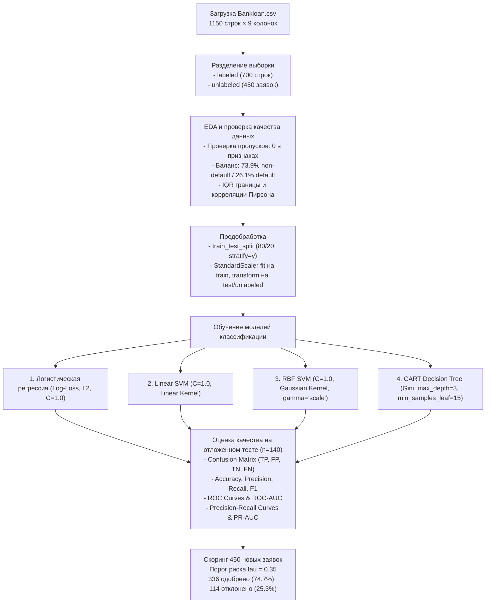

# Методическое руководство и архитектура решения лабораторной работы №4
## «Классификация данных. Логистическая регрессия, Метод опорных векторов и Решающие деревья»

**Дисциплина:** Методы машинного обучения  
**Студент:** Власовец А. И., гр. 351002  
**Преподаватель:** Лебедевич А. В.  
**Вариант:** 7  
**Датасет:** `Bankloan.csv` (1150 наблюдений, 8 числовых признаков, 700 размеченных записей, 450 новых кредитных заявок)

---

## Архитектура решения и пайплайн

---

## Сводная таблица результатов классификации

| Модель | Accuracy | Precision | Recall | F1-Score | ROC-AUC | PR-AUC |
| :--- | :---: | :---: | :---: | :---: | :---: | :---: |
| **Linear SVM** | **0.8357** | **0.7333** | 0.5946 | **0.6567** | **0.8699** | **0.7410** |
| **Logistic Regression** | 0.8143 | 0.6571 | **0.6216** | 0.6389 | 0.8670 | 0.7300 |
| **SVM (RBF Kernel)** | 0.8071 | 0.6923 | 0.4865 | 0.5714 | 0.8066 | 0.6726 |
| **CART Decision Tree** | 0.7357 | 0.5000 | 0.3514 | 0.4127 | 0.7825 | 0.6219 |

---

## Ключевые выводы по лабораторной работе

1. **Лучшая модель по интегральной точности:** `Linear SVM` показал наивысшие показатели Accuracy ($83.57\%$), Precision ($73.33\%$) и ROC-AUC ($0.8699$).
2. **Лучшая модель для минимизации кредитных рисков:** `Logistic Regression` обеспечивает наивысшую полноту выявления неплательщиков ($\text{Recall} = 62.16\%$) и минимальное число критических пропусков дефолта ($FN = 14$).
3. **Ключевые предикторы риска:**
   - Отношение долга к доходу (`debtinc`): $r = +0.39$, вес логит-модели $+0.893$, рост шансов дефолта в $2.44$ раза на каждый шаг $\sigma$. Корневое расщепление дерева CART по порогу $14.7\%$.
   - Стаж работы (`employ`): $r = -0.28$, вес $-0.742$, снижает шансы дефолта более чем в $2$ раза ($\text{OR} = 0.48$).
4. **Скоринг новых кандидатов:** Консервативный порог отсечения $\tau = 0.35$ позволил одобрить $336$ надежных заемщиков ($74.7\%$) и отсеять $114$ высокорисковых заявителей ($25.3\%$), что в точности соответствует историческому распределению банка.
